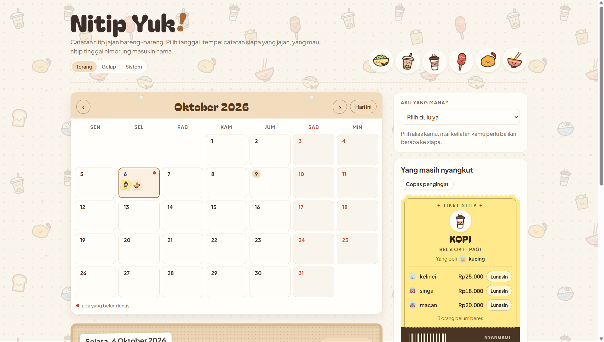
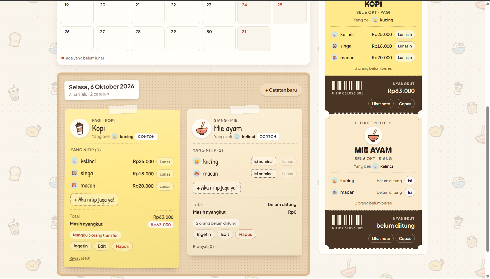
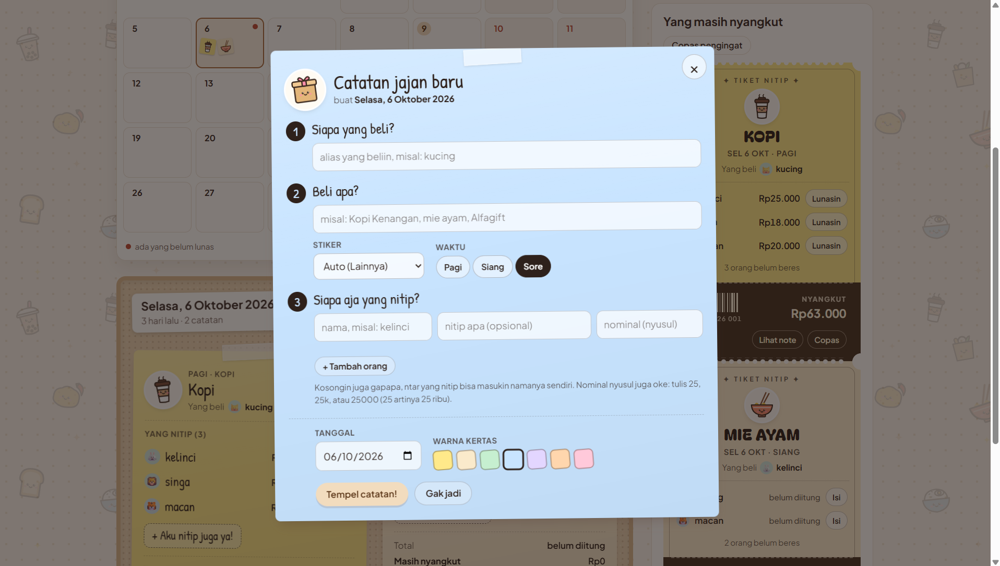

# Nitip Yuk

Catatan titip jajan bareng dalam bentuk kalender dan sticky notes. Klik tanggal, tempel catatan siapa yang beli dan beli apa. Yang nitip bisa nambahin namanya sendiri, dan nominalnya diisi manual kalau udah dihitung.

## Tampilan







## Fiturnya

- **Kalender + papan sticky notes.** Satu tanggal bisa punya banyak catatan (pagi kopi, siang mie ayam, dst). Sabtu–Minggu ditandai tanggal merah.
- **Catatan baru:** siapa yang beli, beli apa, siapa aja yang nitip. Nominal boleh nyusul (`25`, `25k`, atau `25000` sama-sama jadi Rp25.000).
- **"Aku nitip juga ya!"** buat nambahin nama sendiri ke catatan orang.
- **Transfer ke mana:** yang beli bisa nulis sampai 3 rekening atau e-wallet (bebas, misal BCA atau DANA). Infonya tampil di sticky note dan ikut masuk ke pesan pengingat.
- **Tiket "Yang masih nyangkut":** rekap per jajanan kayak tiket bioskop, urut tanggal, bisa tandain lunas.
- **Copas pengingat** buat ditempel di grup, lengkap sama link langsung ke catatannya.
- **Riwayat** per catatan: siapa ngapain, kapan.
- Tema **Terang / Gelap / Sistem**, dan tampilannya nyesuain layar HP.

## Isi folder

| File | Isinya |
| --- | --- |
| `index.html` | Struktur halaman: header, kalender, papan, rekap, dialog catatan baru |
| `style.css` | Semua tampilan (mode terang dan gelap) |
| `favicon.svg` | Ikon tab (mangkuk matcha) |
| `config.js` | Pengaturan Firebase (cuma perlu kalau nggak pakai `worker.js`) |
| `js/util.js` | Helper: tanggal, nominal Rupiah, alias hewan |
| `js/jajan.js` | Stiker kartun jajanan, warna kertas, tebak jenis jajanan dari teks |
| `js/store.js` | Penyimpanan: Firebase atau browser |
| `js/data.js` | Hitungan: total, yang masih nyangkut, pesan pengingat, riwayat |
| `js/tampilan.js` | Gambar kalender, sticky notes, tiket, dan rekap |
| `js/aksi.js` | Klik dan ketik: catatan baru, ikut nitip, isi nominal, lunas, hapus |
| `worker.js` | Server kecil buat nyimpen catatan bareng (Cloudflare Workers + Durable Objects) |
| `wrangler.jsonc`, `.assetsignore` | Pengaturan worker-nya, sama daftar file yang nggak ikut disajikan |
| `firestore.rules` | Aturan Firestore buat ditempel di Firebase Console |

Nggak ada proses build. Semua file langsung dipakai apa adanya.

## Coba di komputer sendiri

Buka lewat server lokal (misalnya ekstensi **Live Server** di VS Code, atau `npx serve`), lalu buka `http://127.0.0.1:...`.

Cara ini nggak jalanin `worker.js`, jadi catatan cuma tersimpan di browser itu, dan ada dua catatan contoh (kopi pagi dan mie ayam siang, ditandai "Contoh"). Mau nyoba yang pakai server: jalankan `npx wrangler dev`, lalu buka alamat yang muncul.

## Biar dipakai bareng satu tim

Kalau web ini jalan bareng `worker.js` di Cloudflare Workers, catatan otomatis disimpan di server (Durable Object) dan semua browser lihat papan yang sama, termasuk perubahan langsung dari orang lain. Nggak perlu setting apa-apa. Catatan yang sebelumnya cuma kesimpen di browser ikut dipindah ke server waktu web dibuka pertama kali (kecuali catatan contoh).

Kalau dipasang di hosting statis biasa tanpa worker, pakai Firebase (gratis):

1. Buka <https://console.firebase.google.com>, klik **Add project**, kasih nama misalnya `nitip-yuk`. Google Analytics boleh dimatikan.
2. Di menu **Build → Firestore Database**, klik **Create database**. Pilih lokasi `asia-southeast2 (Jakarta)`, lalu mulai dalam **production mode**.
3. Buka tab **Rules**, hapus isinya, tempel isi file `firestore.rules`, lalu klik **Publish**.
4. Buka **Project settings** (ikon gerigi) → **General** → bagian **Your apps** → klik ikon web `</>`. Daftarkan app (nama bebas, Firebase Hosting nggak usah dicentang).
5. Salin objek `firebaseConfig` yang muncul, lalu tempel ke `config.js` menggantikan `firebase: null`:

   ```js
   window.NITIP_CONFIG = {
     firebase: {
       apiKey: "...",
       authDomain: "nitip-yuk.firebaseapp.com",
       projectId: "nitip-yuk",
       storageBucket: "...",
       messagingSenderId: "...",
       appId: "...",
     },
     koleksi: "titipan-km",
   };
   ```

6. Refresh halaman. Sekarang catatan yang ditulis siapa pun langsung kelihatan di semua browser. Kalau gagal nyambung, di bawah judul muncul tanda merah **"Gagal nyambung"**.

Catatan dari mode coba nggak ikut pindah ke Firebase. Di Firebase mulai dari papan kosong.

## Online-kan

Web ini cuma file statis (HTML, CSS, JS) tanpa proses build, jadi tinggal kamu deploy sendiri ke hosting statis pilihanmu.

## Soal keamanan

- **Config Firebase bukan rahasia.** Config untuk web memang selalu kelihatan di browser. Yang ngatur siapa boleh apa adalah rules Firestore.
- **Siapa aja yang tahu link bisa ngedit.** Server di `worker.js` dan rules Firestore sama-sama ngizinin siapa aja baca dan nulis, sesuai permintaan "bisa diedit siapa aja". Yang dicek cuma bentuk dan ukuran datanya. Jadi bagiin link-nya cuma di grup kamu, dan pakai alias.
- **Kalau nanti mau dikunci,** bisa ditambah login Google dengan daftar email anggota tim di rules.
